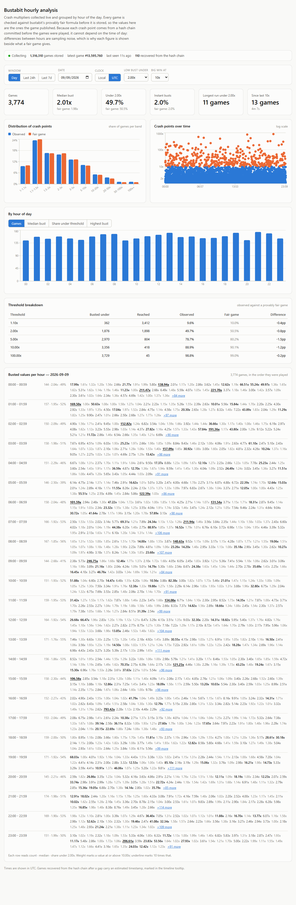

# Bustabit hourly analysis

A dashboard for the crash multipliers from [bustabit.com](https://bustabit.com), grouped by hour of
the day, with distribution, streak and threshold analysis.



The original goal was this view, and it is the last panel on the page:

```
--------------------09/10/2026------------
00:00 - 00:59 -> 1.41x, 18.68x, 17.46x, 4.29x, 1.48x, 1.83x, 44.11x, ...
01:00 - 01:59 -> 1.91x, 1.69x, 1.25x, 1.10x, 2.03x, 26.24x, 1.06x, ...
```

## Running it

Two processes, in two terminals:

```bash
npm install
npm run collector   # watches the game and serves the API on :8787
npm run dev         # the dashboard on http://localhost:5173
```

The collector needs Chrome or Edge installed. It stores games in `data/bustabit.db`.

To fill in history from before you started collecting:

```bash
npm run backfill -- --days 30     # or --games 115000
```

Each run extends further into the past, so running it again goes back further, and an interrupted
run keeps whatever it already wrote.

How far back you can go is fixed by the chain. Multipliers are replayable to game 12,279,451,
where bustabit last changed its salt, which is about **339 days** or 11 months. A request for a
full year stops there and says so.

| Request | Games | Time |
|---|---|---|
| 3 days | 11,800 | ~1 min |
| 30 days | 115,000 | ~7 min |
| Everything (339 days) | 1,186,657 | ~29 min |

A full history is 1.3M games and about 290 MB, mostly the hash on each row and its indexes.

Replaying the multipliers is nearly free: a million games take about seven seconds and no network
at all. The time is spent reading timestamps, and the number of those is capped at 150 by default
however large the range, so a year costs no more requests than a month. Raise or lower it with
`--max-anchors`, or set the spacing directly with `--anchor-every`. Add `--dry-run` to see the
plan without writing or opening a browser.

To find every streak of low multipliers and when each happened:

```bash
npm run runs                        # 10+ games under 2.00x, written to data/low-runs.csv
npm run runs -- --under 1.5 --min 8
npm run runs -- --verify 20         # read exact times for the longest 20 from the site
```

Streaks are counted over the game sequence rather than the clock, so the scan refuses to run if
the stored game numbers are not contiguous, rather than report a streak cut short by a hole in
the data. The threshold is strict: a game at exactly 2.00x ends a run of games under 2x.

To replay a doubling (Martingale) strategy over the stored games:

```bash
npm run simulate -- --balance 2000000 --base 1 --target 2
npm run simulate -- --balance 2000000 --continue      # restart after a bust-out
npm run simulate -- --balance 2000000 --tie-loses     # what if a bust at 2.00x did not pay
npm run simulate -- --balance 2000000 --step 0.5      # raise the cashout 0.5x after each loss
npm run simulate:after -- --after 10 --ladder 50000@2,100000@2.5,200000@3   # bet only after a long low run
npm run simulate:after -- --after 10 --base 10000 --step 0.5                 # same trigger, open-ended doubling ladder
npm run simulate:after -- --after 10 --base 10000 --step 0.5 --trace         # one line per ladder: when, why, result
npm run simulate:after -- --stop-loss 80000 [--stop-loss-strict] [--day-offset 5]   # daily stop-loss, and where midnight falls
npm run optimize -- --split 2026-06-01        # every combination, chosen on one period, judged on the next
npm run simulate:missing -- --stake 100 --rounds 20   # bet on a target that has gone missing from its window
npm run simulate:ladder -- --base 1 --refill          # 1 at 2x, 2 at 3x, 3 at 4x, ... reset on a win
npm run simulate:interval -- --every 5 --look 50 --above 25 --target 20   # one bet per clock tick after a quiet window
```

It reports the result over the data and, beside it, what a fair game predicts for the same
strategy, since a single year is one draw from a distribution with a very fat tail.

Other commands: `npm test` (178 unit tests), `npm run typecheck`, `npm run build`.

## How the data is collected

Bustabit has no HTTP API. Its only data source is a binary WebSocket carrying FlatBuffers
payloads, behind a proof-of-work handshake. Connecting to it directly from Node does not work:
Cloudflare fingerprints the TLS handshake and answers **403** to Node while accepting a browser,
with identical headers. Headless Chrome is refused as well.

So the collector drives a real browser instead of impersonating one. Chrome loads bustabit.com in
an off-screen window, and the DevTools protocol hands over the WebSocket frames the page receives.
The page does its own proof of work, version handshake and reconnects. Nothing is injected and no
input is sent: this observes the traffic of an ordinary visit.

The protocol client that speaks to bustabit directly is still in the tree and still works wherever
that fingerprinting does not apply. Run it with `npm run collector -- --transport=direct`.

## How the data is checked

Every crash point is a pure function of the game's hash: `HMAC-SHA256` under a public salt, taking
the top 52 bits as a uniform draw and mapping it through `99 / (1 - X)`. Two consequences make the
collector self-checking.

**A decoded frame must reproduce its own bust.** The FlatBuffers schemas are not published, so the
field indices were found by inspecting live frames. Rather than trust them, the collector
recomputes the multiplier from the hash and compares. A frame that disagrees is counted and
dropped, never stored. Field order did turn out to differ from the documented guess, and this is
what caught it.

**A hash must chain onto the last one stored.** Game *N*'s hash is the SHA-256 of game *N+1*'s, so
a break means games were missed. The collector then walks the chain back to the last game it has
and regenerates every multiplier in the gap. This runs in practice: after a restart it recovered
the five games played while it was down.

The dashboard shows both counters in its status bar.

## Timestamps

Timestamps are the one thing not in the hash chain. The `gameEnded` push carries no time, so live
games are stamped when the frame arrives. Past games have a creation time available through the
site, which the backfill reads for one game in every few hundred and interpolates between, using
the fact that a game's duration follows from its multiplier:

```
endedAt = created + 5000 ms + 14427 * ln(bust)
```

Checked against a game collected live, that predicts the observed crash within **52 ms**. Checked
against real timestamps across backfilled ranges, the estimates hold up well against an hour
bucket of 3600 s, and widening the spacing costs little:

| Spacing | Range covered | Mean error | Worst |
|---|---|---|---|
| every 500 games | 2 days | 5.6 s | 15.6 s |
| every 770 games | 30 days | 6.4 s | 27.1 s |
| every 3,956 games | 339 days | 7 s | 26 s |

The error does not grow with the range, because each segment is pinned at both
ends rather than extrapolated from one.

Each game records where its timestamp came from, and the dashboard says which ones are estimated.

Games seen mid-round arrive before the collector has been told the round number, so they are
stored by hash alone. The chain settles the number as soon as a neighbour is stored, and both the
collector and the backfill repair those on startup.

## What the numbers mean

Bustabit's crash points come from a hash chain committed in February 2024 and a salt fixed by a
Bitcoin block. They cannot depend on the time of day, so **differences between hours are sampling
noise**. The dashboard is built to make that legible rather than to hide it: every figure appears
beside what a provably fair game gives, since `P(bust >= t) = 0.99 / t`.

Over 1,316,199 games spanning 339 days, the observed values sat within 0.045 percentage points of
fair at every threshold:

| Target | Observed | Fair game | Difference |
|---|---|---|---|
| 2x | 49.4555% | 49.5000% | -0.0445pp |
| 5x | 19.8020% | 19.8000% | +0.0020pp |
| 10x | 9.9040% | 9.9000% | +0.0040pp |
| 100x | 0.9817% | 0.9900% | -0.0083pp |
| 1000x | 0.0916% | 0.0990% | -0.0074pp |

### The hour-of-day question, answered

With a full year collected there are about 54,800 games in each hour bucket, which is enough to
test the premise properly rather than assert it. Hourly medians run from 1.95x to 1.99x against a
fair 1.98x, and the share reaching 2x runs from 48.92% to 49.80% against a fair 49.50%.

A chi-square test of homogeneity across the 24 hours, at 23 degrees of freedom where 35.2 would
be significant at p=0.05:

| Threshold | chi-square | p |
|---|---|---|
| 1.01x | 23.1 | 0.46 |
| 2x | 24.2 | 0.39 |
| 5x | 33.2 | 0.08 |
| 10x | 30.3 | 0.14 |
| 100x | 18.9 | 0.71 |

No threshold shows an hourly effect. That is the expected result, and now it is a measurement
rather than an argument from the algorithm.

### Low streaks

Across the same 339 days there were **696** streaks of 10 or more consecutive games under 2.00x,
against roughly 703 predicted by a fair game. The longest ran to 19 and happened three times.
Streaks decay at almost exactly the rate independence predicts, each extra game roughly halving
the count:

| Length | Count |
|---|---|
| 10 | 351 |
| 11 | 165 |
| 12 | 77 |
| 13 | 58 |
| 14 | 19 |
| 15 | 9 |
| 16 | 5 |
| 17 | 6 |
| 18 | 3 |
| 19 | 3 |

A streak of 19 lasts about three and a half minutes. `npm run runs` writes every one of them with
its dates and times.

### A doubling strategy, replayed

A common system bets 1 bit at 2.00x, doubles after each loss and resets after each win, so every
completed cycle nets exactly 1 bit. Replayed over these 339 days with a 2M bit bankroll it never
busted out and finished **+650,986 bits**, one for each of the 650,989 wins.

That result rests on a single game. The 19-game streak on 4 November 2025 ended on a bust at
exactly 2.00x. Bustabit's published game server pays a cashout when `autoCashOut <= crashPoint`,
so that game paid. Had it busted at 1.99x, the streak becomes 20, the 21st bet of 1,048,576 bits
cannot be placed, and the bot is down 993,837 bits on day 29.

The arithmetic behind that: a 20-loss streak has probability 0.505^20, about 1 in 860,000
cycles. With 700,000 cycles a year that is 0.82 expected bust-outs, a 56% chance of at least one.
Each costs 1,048,575 bits against the 1 bit a cycle earns, for an expected value of about
**-154,000 bits a year**. The house edge does not go away; doubling concentrates it into rare,
large losses. A bankroll of 4.2M survives a 20-streak but only moves the same edge to a 21-streak,
with an expected value of about -172,000 a year.

**Raising the target during a streak makes it far worse.** A natural refinement is to aim higher
the deeper the streak goes, so the eventual win pays for the risk: 2x, then 2.5x, 3x and so on.
But a higher target is a less likely win. By the 20th bet the target is 11.5x, which only 8.6% of
games reach, so every step makes the streak *more* likely to continue. A 20-loss streak goes from
1 in 860,000 cycles to **1 in 80**. Replayed over the same data, this version lost the whole 2M
bankroll in 1,110 games, about seven hours into the first day, across 14 bust-outs. The big deep
wins the scheme is designed around almost never arrive: the largest it ever collected was 131,072
bits, while the cost of getting there was over 2M.

**Waiting for a signal does not help either.** Another intuition: after ten or more games under 2x,
a high one is due, so bet only then. `npm run simulate:after` replays that: wait for a 10+ run to
end, then bet 50,000 at 2x, 100,000 at 2.5x, 200,000 at 3x, stopping at the first win. Over these
339 days it was up 700,000 after the first month and had lost 1,750,000 of its 2M by the 46th
day, after which it could no longer fund the ladder. The reason is in the win rates of the bets
placed right after a long run:

| Bet after a 10+ run | Won | Any game |
|---|---|---|
| 2x | 46.0% | 49.5% |
| 2.5x | 38.9% | 39.6% |
| 3x | 27.3% | 33.0% |

Nothing about the run before changes the game after. Each game's outcome is fixed by a hash chain
committed before it was played, and the data agrees to within sampling noise. The trigger only
chose which games to lose 1% on.

**Making that ladder open-ended shows what variance looks like.** The same trigger, but starting
at 10,000 and doubling with a rising target until a win, with no cap but the bankroll. Over these
339 days it went from 2M to a peak of **9,350,000** on 25 October 2025, three weeks in, on the
back of one win of 4.49M and two of 1.93M. It was at zero by 12 November. Six ladders ran the
bankroll out, the largest costing 5.11M in a single sequence. A 2M bankroll funds seven rungs, the
last being 640,000 at 5x, and a fair game fails that ladder 1 time in 14. With 756 triggers a year,
that is about 52 such failures at 1.27M each. The fixed-target version of the same ladder lasted
until August before reaching zero as well.

**A bigger bankroll makes it worse, not safer.** Rerun with 10 billion bits, so money never limits
the ladder and all 696 runs get played: it reached the same peak in October, then went bankrupt
on 27 March 2026, losing all 10,000 BTC. With no cap, ladders reached rung 19 with stakes of 2.6
billion, and one failure cost 5.24 billion in a single sequence. Expected value per trigger scales
with the wager and stays at exactly minus 1% of it: -1,624 bits with a 2M bankroll, -888,639 with
10 billion. Across 353 ladders the first bet after a 10+ run won 47.3% of the time against 49.5%
for any game, so the trigger added nothing and the depth only decided how large the losses were.

**A daily stop-loss stops the bankruptcies but not the loss, and exposes how much is luck.** Adding
an 80,000 bit daily stop-loss to that bot caps how deep a ladder can go, which removes both the
huge wins and the huge failures. What remains is about 700 short ladders a year wagering 20M in
total, and 1% of 20M is 200,000. The replay agrees, with a twist: the result depends on which
hour midnight falls in, a parameter with no connection to the game. Sweeping all 24 boundaries
with the usual definition, stop once the day's net loss reaches 80,000:

| Day boundary | Outcome |
|---|---|
| 9 of 24 | bankrupt, between February and April 2026 |
| 15 of 24 | survived, finishing between -1,600,000 and exactly 0 |
| best | 0 |
| average | -1,240,000 |

The bankruptcies happen because intraday wins extend the rope: a day that is up 300,000 can then
lose 380,000 before the stop fires, and a deep ladder does exactly that. A strict version that
refuses any bet which could take the day past -80,000 never goes bankrupt and never has a day
worse than -80,000, but across the same 24 boundaries it finishes between -50,000 and -1,070,000,
averaging -656,000. No boundary in either version ends in profit. A one-hour shift in midnight
moving the result by two million is the clearest possible sign that the outcome is variance around
a 1% loss rather than anything the strategy is doing.

### Searching for the best bot

`npm run optimize` replays every combination of the ideas above, 630 bots in all: continuous or
triggered on runs of 8 to 15, bases of 1,000 to 50,000, targets of 1.5x to 3x, fixed or rising,
and stop-losses from none to 200,000 in both forms. The point of the tool is the split. Each bot
is ranked on the first 237 days and then replayed, fresh, on the last 102 days it was not chosen
on. A bot with a real edge does well on both. A bot fitted to noise does not.

| | |
|---|---|
| Profitable on the training period | 193 of 630 |
| Profitable on the test period | 244 of 630 |
| Profitable on both | 108 of 630 |
| Correlation between a bot's training and test profit | **0.03** |

A correlation of 0.03 means how a bot did in the first eight months says nothing about how it did
in the last three. The bot ranked first on training, a continuous doubling ladder with a strict
80,000 stop, made 15.2M there and -20,000 out of sample. It placed 43,108 bets and won 21,339,
a rate of 49.5%, exactly the house's. Its profit came from a handful of enormous stakes the stop
had allowed on days that were already far up, one of them 5.12M, that happened to land. On the
1.37B it wagered the house edge expects -13.7M. That is what the best bot out of 630 looks like:
not an edge, a lottery ticket that paid once.

Roughly a third of any set of bots will show a profit over any period, because a third of coin
flips come up heads. Picking the winners and running them forward does not keep the profit,
because nothing about them caused it. The full table is in `data/optimize.csv`.

### Betting on what has gone missing

A gentler idea, with a fixed stake and no doubling: look back over the last 70 rounds for a 10x,
140 for a 20x, up to 700 for a 100x. Each window is sized so a fair game puts about seven hits in
it, so an empty one looks overdue. When one is empty, bet 100 bits on that target for up to 20
rounds, stop at the first win, and go back to watching. `npm run simulate:missing` replays it.

Over 339 days a window was empty at 519 checkpoints. The bot placed 7,651 bets, wagered 765,100
bits, and finished at **-13,100**, against a house edge on that wager of -7,651. It cannot go
bankrupt and never drew down more than 61,000. The question it was built to answer:

| Missing target | Hit within 20 rounds | Any 20 rounds, fair game |
|---|---|---|
| 10x | 91.5% of 94 | 87.6% |
| 20x | 67.9% of 78 | 63.8% |
| 40x | 33.3% of 66 | 39.4% |
| 60x | 22.0% of 41 | 28.3% |
| 90x | 18.2% of 55 | 19.8% |
| 100x | 15.4% of 52 | 18.0% |

Some above, some below, and 246 wins in total against 241 expected. A target that has gone
missing is exactly as likely to appear as one that has not.

The bot as actually specified bets for as many rounds as the target value, 10 rounds for a
missing 10x up to 100 for a missing 100x, and takes the highest target when several are missing
(`--rounds target --pick highest`). Each of those stretches expects 0.99 hits, so a fair game
wins about 63% of them whatever the target. Over the year: 365 activations, 237 wins, a 64.9%
rate, and **-22,100 bits** against -7,651 for 1% of the wager.

| Missing target | Rounds bet | Won | Fair | Average net per activation |
|---|---|---|---|---|
| 10x | 10 | 85 of 127, 66.9% | 64.7% | +62 |
| 30x | 30 | 32 of 52, 61.5% | 63.5% | -102 |
| 50x | 50 | 13 of 16, 81.3% | 63.2% | +1,675 |
| 70x | 70 | 6 of 10, 60.0% | 63.1% | -940 |
| 100x | 100 | 12 of 20, 60.0% | 63.0% | -1,655 |

Whichever way the rounds and the tie-break are set, the bot bets on precisely the 7,651 games
during which some window was empty, wagers the same 765,100, and loses about 1% of it. The
settings only decide which target the stake rides on, and so how the same loss is distributed.

**When one of these shows a profit.** A short window makes the bot fire often: watch the last 50
rounds for a 10x, bet 100 at 10x for up to 10 rounds when none appears, pause 5 minutes after a
win (`--windows 1 --window-unit 50 --target-unit 10 --rounds 10 --cooldown 5`). Over the year it
won 66.2% of 1,118 activations against a fair 64.7%, and finished **+23,000** on 717,000 wagered.

That is not an edge, and the arithmetic says so without needing another year of data. Each drought
ends on the first 10x, so its result is 900 minus 100 for each losing round before it. The wait is
geometric, expected 10.1 rounds, so each drought is worth -10 bits on average with a spread of
±959. Over 740 droughts that is an expected -7,475 with a spread of ±26,082:

| | |
|---|---|
| Expected over the year | -7,475 |
| Observed | +23,000 |
| One standard deviation | ±26,082 |
| Distance from expectation | **1.17 sd, p = 0.12** |

An ordinary year for this bot runs anywhere from -60,000 to +45,000. Landing at +23,000 is the
same kind of event as flipping seven heads in ten tosses. Splitting the year agrees: +6,100 in the
first half and +16,900 in the second, but by quarter it reads -3,000, +9,800, +19,500, -3,300.
Nudging the window from 50 to 40 rounds turns +23,000 into -12,600 while tripling the number of
bets, which is the signature of noise rather than a setting that matters.

The 5-minute pause changes nothing at all: cooldowns of 0, 1, 5 and 15 minutes all place exactly
the same 7,170 bets for exactly the same result, because a win means a 10x just landed, so the
window is no longer empty and the bot would have sat out those rounds regardless.

**The same bot at every target.** Take target T, watch a window of 5T rounds, bet up to T rounds
at 100 bits. Every member of this family has the same expected loss, about -8,500 a year, because
each turns over roughly the same amount. What changes is the spread, and with it the headline:

| Target | Window | Droughts | Profit | Expected | 1 sd | z | p |
|---|---|---|---|---|---|---|---|
| 10x | 50 | 740 | +23,000 | -7,475 | 26,082 | 1.17 | 0.24 |
| 20x | 100 | 424 | -5,200 | -8,566 | 40,556 | 0.08 | 0.93 |
| 40x | 200 | 212 | +15,000 | -8,566 | 58,097 | 0.41 | 0.69 |
| 50x | 250 | 171 | +82,200 | -8,636 | 65,387 | 1.39 | 0.16 |
| 70x | 350 | 124 | +149,000 | -8,768 | 78,177 | 2.02 | 0.04 |
| 90x | 450 | 101 | +69,500 | -9,182 | 90,859 | 0.87 | 0.39 |
| 100x | 500 | 83 | -68,000 | -8,384 | 91,568 | -0.65 | 0.52 |

Seven of the ten show a profit, up to +149,000, and one clears p = 0.05. None of that is an edge.
The standard deviation grows from 26,000 to 92,000 as the target rises, because the same turnover
arrives in fewer, larger payouts, so the results scatter more widely around the same small loss.
Testing ten bots and finding one at p = 0.04 is expected: at that threshold one in twenty looks
significant by chance, and here ten were tried. The 70x row is the winner of a lottery, not a
discovery, which is why the 100x row next to it lost 68,000 doing exactly the same thing.

Pushing the same family out to 1000x makes the point unarguable:

| Target | Window | Droughts | Profit | Expected | 1 sd | z |
|---|---|---|---|---|---|---|
| 200x | 1,000 | 45 | -298,800 | -9,091 | 135,183 | -2.14 |
| 300x | 1,500 | 39 | +18,700 | -11,818 | 188,930 | 0.16 |
| 500x | 2,500 | 25 | +86,800 | -12,626 | 252,275 | 0.39 |
| 700x | 3,500 | 14 | -415,700 | -9,899 | 264,374 | -1.53 |
| 1000x | 5,000 | 13 | +111,000 | -13,131 | 364,017 | 0.34 |

Results now range from -415,700 to +144,000 while the expected loss stays near -9,000 throughout,
and the spread reaches ±364,000 on 13 droughts a year. The 200x row clears p = 0.05 in the losing
direction, the mirror image of the 70x row above and equally meaningless. Across the full twenty
variants tried, twelve profited and two crossed p = 0.05, one each way, which is precisely what
twenty coin-flip experiments produce.

**The simplest form: one window.** Watch only the last 700 rounds for a 100x; when there is none,
bet 100 bits at 100x for up to 100 rounds, stop on a win, then watch again
(`--windows 1 --window-unit 700 --target-unit 100 --rounds 100`). Because a 100-round miss
leaves the window still empty, the bot re-arms at once, so in effect it bets on every game from
the moment a drought reaches 700 rounds until the next 100x arrives. There were 15 such droughts
in the year. After the 700-round mark the 100x took 113 more rounds on average, against a fair
expectation of 101. Each drought paid 9,900 once and cost 100 a round while waiting, for
**-19,200** over the year on 169,200 wagered. The worst drought, on 29 June 2026, ran 484 rounds
past the mark and cost 38,400 before its 100x came.

**Winning every time and still losing.** Let the bot bet for the whole window instead, 350
rounds for a missing 50x and 700 for a missing 100x, taking the highest target when several are
missing (`--rounds window --pick highest`). Each window is long enough that a fair game hits the
target 99.9% of the time, and over the year the bot did better than that: **245 activations, 245
wins, not one miss**. It finished at **-8,100 bits**, against -7,651 for 1% of what it wagered.

| Missing target | Won | Pays | Rounds until the hit, fair | Average net per activation |
|---|---|---|---|---|
| 10x | 85 of 85 | +900 | 10.1 | +93 |
| 30x | 34 of 34 | +2,900 | 30.3 | +50 |
| 50x | 9 of 9 | +4,900 | 50.5 | +2,578 |
| 70x | 9 of 9 | +6,900 | 70.7 | -856 |
| 100x | 8 of 8 | +9,900 | 101.0 | -1,937 |

A 100x pays 9,900 on a 100 bit stake, but on average it arrives on the 101st round, after
10,000 bits of losing stakes. The payout and the wait cancel to within the house's 1%, at every
target, by construction: the chance of reaching a target is 0.99 divided by the target, so the
expected wait is the target divided by 0.99, and the win is worth the target minus one. A win rate
of 100% is not an edge. It is a long series of small losses collected in one payment, and the
costliest "win" of the year was a 100x that took 484 rounds and netted -38,400.

Streaks behave the same way. Across 2,221 consecutive games, two instant busts never once landed
back to back, which is exactly what a fair game predicts: only 0.87 such pairs are expected, so
seeing none happens about 42% of the time.

One detail worth knowing: **1.98% of games show 1.00x**, not 1%. The 1% house edge is the chance
the formula lands below 1, but everything that rounds down to 100 also displays as 1.00x.

### A rising ladder: n bits at (n+1)x

Bet 1 bit at 2x; after a loss bet 2 at 3x, then 3 at 4x, and so on; any win goes back to the
start. A win at rung n pays n x n against n(n-1)/2 already lost, so **every finished ladder is a
profit** of n(n+1)/2 bits. The catch is the ladder that does not finish: a 2,000,000-bit balance
covers 1,999 rungs, and a fair game loses all of them about once in 1,843 ladders, a few times a
week at roughly 400 ladders a day.

`npm run simulate:ladder` replays it on every game:

| | Result |
|---|---|
| Started 2025-10-08 with 2,000,000 | grew to about 29,000,000 on deep wins (best: rung 4,517, +10.2M) |
| One ladder from 2025-10-16 | ran 7,355 rungs, cost 27,051,690, balance gone on 2025-10-19 |
| Refilled each time, full year | 50 refills, 251 lost ladders, net **-100,606,734** |
| Turnover | 785,925,606 bits; expected cost at 1% is -7,859,256 |

Where ladders finished matched a fair game at every depth (49.4% on rung 1 vs 49.5% fair, 1.52%
in rungs 51-200 vs 1.52%). The bankroll grows in long stretches and then one ladder takes it all:
the worst ran 14,340 rungs and cost 102,824,970. The realised loss is far beyond the expected 1%
only because a handful of enormous ladders dominate the year; the expected cost is still 1% of
turnover. In practice the table limits on bet size and maximum profit per game would also stop the
deep rungs (a 14,000-bit bet at 14,000x) long before the balance did.

### Every five minutes, after a quiet window

Every five minutes on the clock, look at the last 50 busts; if none reached 25x, bet 1,000 at 20x
once, otherwise skip. `npm run simulate:interval` replays it: 97,689 checks, 13,221 bets (13.5%
of checks, 13.3% fair), **646 wins, 4.89%** against a fair 4.95% (654 +/- 25), net **-301,000**
against an expected -132,000 +/- 499,000.

The first version of this simulator reported +25,119,000 and a 14.5% win rate. It bet on the game
already in flight when the clock ticked, which a real bot cannot do. That game is also not a
random one: a clock tick is far more likely to land inside a long flight, and long flights are
high busts. A 20x+ game lasts about three times as long as the average game, which is exactly the
gap between 4.95% and 14.5%. The bot can only bet on the next game to start, and that game is
ordinary.

## Layout

```
shared/       types, fair-game expectations, and the analysis functions, all unit-tested
collector/    browser transport, FlatBuffers decode, provably-fair verification, SQLite, API
web/          the React dashboard
```

The analysis lives in `shared/stats.ts` and is pure, so hourly grouping, thresholds, streaks and
the histogram are tested without a browser or a database.

## Configuration

Everything is optional and read from the environment:

| Variable | Default | Purpose |
|---|---|---|
| `BUSTABIT_TRANSPORT` | `browser` | `browser` or `direct` |
| `BUSTABIT_BROWSER_PATH` | auto | Chrome or Edge, if not in a usual location |
| `BUSTABIT_CLIENT_VERSION` | `30` | Only used by the direct transport |
| `API_PORT` | `8787` | Where the collector serves its API |
| `DB_PATH` | `data/bustabit.db` | Where games are stored |

## Limits

- **The client version is pinned.** The direct transport stops with a clear message if bustabit
  bumps it. The browser transport is immune, since the page ships its own.
- **The FlatBuffers schemas are inferred.** If bustabit changes them, frames are rejected rather
  than misread. Run `npm run collector -- --dump` to inspect the new layout.
- **Games before 12,279,451 are not backfilled**, so history stops at about 339 days. Those games
  were signed with BLS12-381 rather than plain HMAC, and older ones again used a different hashing
  scheme. The backfill stops at the boundary rather than storing wrong numbers.
- **Wider ranges mean coarser timestamps.** With the default cap of 150 measured times, a 30-day
  backfill spaces them 770 games apart and a year spaces them 8,700 apart. Multipliers stay exact
  either way; only the times are estimated, and the dashboard marks them.
- Bustabit's `robots.txt` disallows AI crawlers, and its terms may restrict automated access. This
  reads one connection's worth of public game results, the same as an open browser tab, but the
  terms are worth reading before running it continuously.
